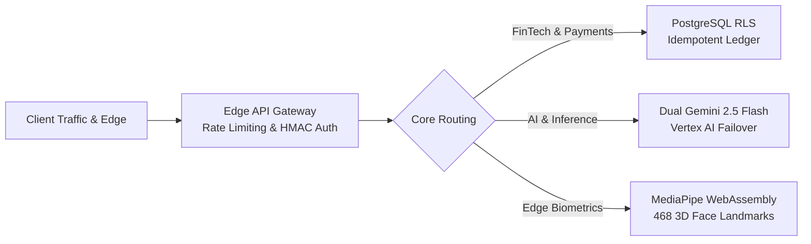

  <picture>
    <source media="(prefers-color-scheme: dark)" srcset="https://capsule-render.vercel.app/api?type=waving&color=auto&height=240&section=header&text=Ayoola%20Damisile&fontSize=60&fontAlignY=32&desc=Solutions%20Architect%20%26%20Cloud%20Systems%20Engineer&descAlignY=52&animation=fadeIn&fontColor=fff">
    
  </picture>

  

  
  
  
  
  
  
  
  
  

 

---

### 🏛️ Core Architecture Overview

---

### 🚀 Anchor Production Systems

#### 1. [BuySolar.ng](https://buysolar.ng) — Resilient FinTech Edge Architecture & Dual Gemini Quoting
> **Role:** Sole Founding Software Engineer (Built from scratch) · CAC: 8168912
* **Distributed Edge:** 682 edge routes engineered with Next.js and optimized for high-volume transactions.
* **Cryptographic Reconciliation:** Enforces raw-body Paystack HMAC SHA-512 webhook signature verification with cryptographic idempotency nonces, eliminating double-allocation race conditions during payment bursts.
* **Multimodal Solar AI Engine:** Dual Gemini 2.5 Flash pipeline with circuit-breaker failover (<800ms latency), translating rooftop imagery and appliance loads into production solar equipment quotes.
* **Corporate Platform:** Engineered corporate energy portal at [lightsupenergy.com](https://lightsupenergy.com).

#### 2. [checkIn](https://github.com/Ayoola-tech2024/checkIn) — Campus Facial Geometry & Offline Geofence Engine
> **Role:** Lead Systems Architect · Deployed at FUTA SLIT
* **Edge Geometry Matching:** Real-time 468-point 3D facial landmark geometry extracted with Google MediaPipe WebAssembly.
* **Client-Side Verification:** Geometric Euclidean landmark comparisons run strictly client-side; zero face images or templates stored on servers (GDPR/NDPR compliant).
* **Offline Resilience:** Haversine spatial geofencing combined with an idempotent IndexedDB transactional drain queue, ensuring zero attendance loss during campus connectivity dropouts.

#### 3. [fixmcp](https://github.com/Ayoola-tech2024/fixmcp) — Model Context Protocol Doctor & Diagnostic Stdio Server
> **Published on npm:** `npx fixmcp` · [npm link](https://www.npmjs.com/package/fixmcp)
* **Dual-Mode Architecture:** Operates both as a CLI doctor (`npx fixmcp`) and a standard MCP stdio server (`fixmcp serve`), exposing 4 diagnostic tools (`diagnose_mcp_configs`, `test_mcp_server`, `repair_mcp_configs`, `list_agent_config_paths`).
* **Real stdio JSON-RPC Handshakes:** Tests live MCP server processes with JSON-RPC 2.0 `initialize` and `tools/list` handshakes across Claude Code, Claude Desktop, Cursor, VS Code, opencode, and Codex. 24 passing automated tests.

#### 4. [@damisile_ayoola/envvault](https://github.com/Ayoola-tech2024/envvault) — Zero-Disk Runtime Secrets Manager
> **Published on npm:** `npm install -g @damisile_ayoola/envvault` · [npm link](https://www.npmjs.com/package/@damisile_ayoola/envvault)
* **Cryptographic Memory Injection:** Injects decrypted environment variables directly into process memory (`process.env`) via `envvault run`, preventing plaintext `.env` disk leaks.
* **High-Stretching KDF & Integrity:** 100,000 PBKDF2 SHA-512 iterations with 32-byte salt, AES-256-GCM authenticated encryption, and an 18-test tamper detection suite.

---

### 🌐 Standards & Open Source Contributions

* **W3C Web Machine Learning Spec**:
  * Author of Issue [#288](https://github.com/webmachinelearning/web-nn/issues/288) discovering user-activation approval loop bypasses when AI agents automate the DOM; cited directly by specification editors in Issue #365.
* **InsForge (YC W24)**:
  * PR [#1965](https://github.com/InsForge/InsForge/pull/1965): Authored Paystack payment provider integration for West African developers (15 green CI suites, clean merge state).
  * Security Code Reviews: Audited PR [#2218](https://github.com/InsForge/InsForge/pull/2218) (PostgreSQL DDL event triggers for Row Level Security) and PR [#2219](https://github.com/InsForge/InsForge/pull/2219) (SMTP host SSRF prevention & DNS rebinding mitigations).
* **Published npm Packages**:
  * [`fixmcp`](https://github.com/Ayoola-tech2024/fixmcp) (v0.2.0): Cross-agent MCP configuration doctor & stdio diagnostic server (24 passing unit tests).
  * [`@damisile_ayoola/envvault`](https://github.com/Ayoola-tech2024/envvault): Zero-dependency AES-256-GCM runtime secrets manager (18 passing unit tests).

---

### 🛠️ Systems & Cloud Stack

* **Cloud & Infrastructure:** Google Cloud Platform (Cloud Run, Cloud SQL, VPC, Vertex AI), Docker, Coolify, Traefik, Nginx.
* **Languages & Runtimes:** TypeScript, JavaScript (Node.js/Bun), Python, SQL (PostgreSQL, SQLite), Bash.
* **Security & Reliability:** AES-256-GCM, HMAC SHA-512, PBKDF2, Zero-Trust Architecture, Row-Level Security (RLS).
* **Architecture:** Idempotent transaction queues, Circuit breakers, WebAssembly, Multi-agent workflows.

---

### 📬 Connect & Verified Footprint

- 🌐 **Portfolio & Case Studies:** [damisile.name.ng](https://www.damisile.name.ng)
- 💼 **LinkedIn:** [linkedin.com/in/damisile-ayoola-096a7b382](https://www.linkedin.com/in/damisile-ayoola-096a7b382)
- 🐦 **X (Twitter):** [@damisiledev](https://x.com/damisiledev)
- 📧 **Email:** [damisileayoola@gmail.com](mailto:damisileayoola@gmail.com)
